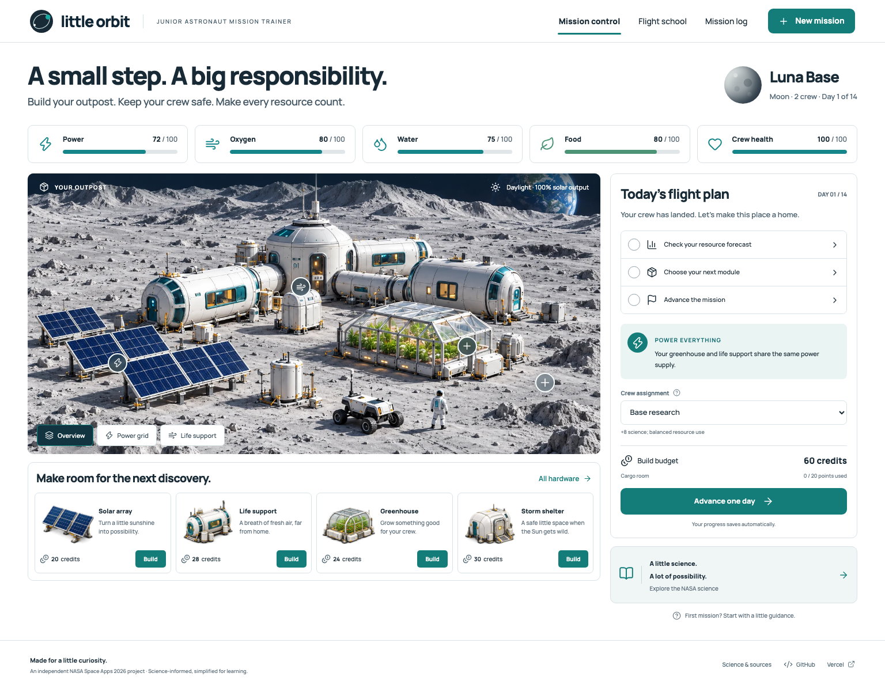

# Little Orbit

**A small step. A big responsibility.**

A playable junior astronaut mission trainer for the 2026 NASA Space Apps challenge **[Build a Junior Astronaut Mission Trainer](https://www.spaceappschallenge.org/2026/challenges/build-a-junior-astronaut-mission-trainer/)**. Students build a Moon or Mars outpost, predict the consequences of their decisions, and keep a crew healthy across a 14-turn mission.

**[Play Little Orbit →](https://little-orbit-seven.vercel.app/)**

| Link                     | Destination                                                                   |
| ------------------------ | ----------------------------------------------------------------------------- |
| Live website             | **https://little-orbit-seven.vercel.app/**                                    |
| Public GitHub repository | [Yoriichi-0u0/little-orbit](https://github.com/Yoriichi-0u0/little-orbit)     |
| Vercel project           | [Little Orbit on Vercel](https://vercel.com/chia-0u0-s-projects/little-orbit) |
| Science and citations    | [Research ledger and model boundaries](docs/research.md)                      |



## The challenge, made playable

Space missions are systems. A garden cannot produce food without water and electricity. A battery cannot create energy. Producing oxygen can drain water reserves. A shelter can protect the crew while using precious construction capacity.

Little Orbit makes those dependencies visible in an exact next-turn forecast and records the results in a mission journal. The player predicts, chooses, observes, and adjusts.

- **Two destinations:** a fictional lunar polar ridge with terrain shadows, and a Martian base with lower solar generation and dust storms. Moon turns are Earth days; Mars turns are approximately 24.6-hour sols.
- **Eight hardware options:** solar arrays, life support, greenhouses, storm shelters, water recyclers, battery banks, surface reactors, and a Mars-only MOXIE-inspired oxygen lab.
- **Five connected resources:** stored power, oxygen, water, food, and crew health. Power demand constrains production; water availability constrains oxygen and crops.
- **Four crew assignments:** base research, rover expedition, crew recovery, and shelter in place. Science rewards compete with resource consumption and protection.
- **Four scripted incidents:** a water leak, solar particle event, low-light interval, and crop-maintenance problem. Costs are disclosed and every incident has a free fallback.
- **Real consequences:** credits and cargo limits, delayed crop maturation, recovery from shortages, mission completion or evacuation, and a downloadable debrief.
- **Six short science lessons:** optional questions with feedback, saved mastery, discussion prompts, and a library of **14 primary references** (13 NASA/JPL sources plus the challenge).
- **Local mission collection:** compare completed strategies, resource trends, and science without publishing student identities.

## Quick start

The app opens with a ready lunar outpost. Open **Check your resource forecast**, inspect a module, choose your **Crew assignment**, and **Advance one day**. At an incident, choose a response and check the updated forecast before advancing.

For a first run, an extra solar array and water recycler are useful experiments. Watch the water reserve, and compare research with exploration. A pre-landed supply pack can provide a small backup. Flight school explains the NASA science behind these choices.

Use **New mission** to choose Moon or Mars, two or three astronauts, and an outpost name. Mission log exports a Markdown debrief and offers a printable classroom report.

## Classroom use

Suggested ages 10+, around 15–25 minutes per run. Have learners predict a change before pressing Advance. Compare two runs that differ in a single decision. Discussion prompts are included in Flight school and the debrief.

The numeric model is deliberately simplified. Resources are normalized game units, **not actual mission-design quantities or radiation doses**. Crop maturation, hardware output, incident dates, health effects, credits, and cargo points are authored learning mechanics. NASA sources support the relationships rather than these numeric settings. Read [the full science mapping](docs/research.md).

## Run locally

Use Node.js 24 and npm.

```sh
npm ci
npm run dev
```

Vite prints the local URL (normally `http://127.0.0.1:5173`). No credentials, API keys, or environment variables are required.

```sh
npm run test       # 18 simulation and persistence tests
npm run check      # strict TypeScript
npm run build     # production bundle in dist/
npm run preview   # preview the production build
```

The repeatable browser pass needs Chromium:

```sh
npx playwright install chromium
# Keep a dev server on 4173 running in a separate terminal:
npm run dev -- --port 4173
# Then:
npm run test:browser
```

Override `QA_BASE_URL` to test another host. `QA_CAPTURE_ONLY=1` saves fresh product screenshots without running the full mission workflows. Browser QA output defaults to ignored `tmp/browser-qa/`.

## Hosting and data

Hosted on Vercel. The public website is linked above and in the repository homepage. The project is configured for Git deployments from this repository. Production builds run strict TypeScript before Vite. GitHub Actions runs the simulation tests and production build on main and pull requests.

Progress, quiz mastery, and the ten most recent completed missions use browser `localStorage`. They stay on the current browser/device. Clearing site data removes them; exported debriefs provide a portable copy. Storage errors leave the session playable and show a saving notice.

**Supabase is unnecessary for this version.** There are no accounts, shared leaderboard, or server-side student records. No backend credentials are embedded in the website.

## Implementation and evidence

React, TypeScript, Vite, Manrope, and Lucide UI icons. The pure simulation lives in `src/game/model.ts`; validation and persistence are separate from the views. Navigation, forms, construction, forecasts, chart values, incidents, and quizzes are real code-native controls.

The outpost illustrations depict starter equipment. Construction changes installed counts, system summaries, and simulation forecasts; this is an outpost-management game rather than a terrain-placement editor. Moon/Mars environments and hardware art were generated with the built-in image-generation tool and saved as optimized local WebP assets. See [art provenance and prompts](docs/asset-prompts.md).

- [Game design](docs/game-design.md)
- [Research, citations, and limitations](docs/research.md)
- [Design system](docs/design-system.md)
- [Verification and visual comparison](docs/verification.md)

Validation includes full 14-turn Moon and Mars runs, persistence, incident choices, learning feedback, exports, keyboard dialog behavior, and all three screens at 1440, 768, 390, and 320 pixels. Automated checks are described in the verification document. No physical-device test or classroom study is claimed.

## License and attribution

Code and original project content are offered under the [MIT license](LICENSE). Referenced NASA material remains subject to its source terms; source text is summarized rather than copied at length. Manrope is distributed under the SIL Open Font License; Lucide uses the ISC license. Project illustrations are original AI-generated art and are not NASA images or measured terrain.

Little Orbit is an independent NASA Space Apps project, not an official NASA product or a NASA-endorsed simulation.
